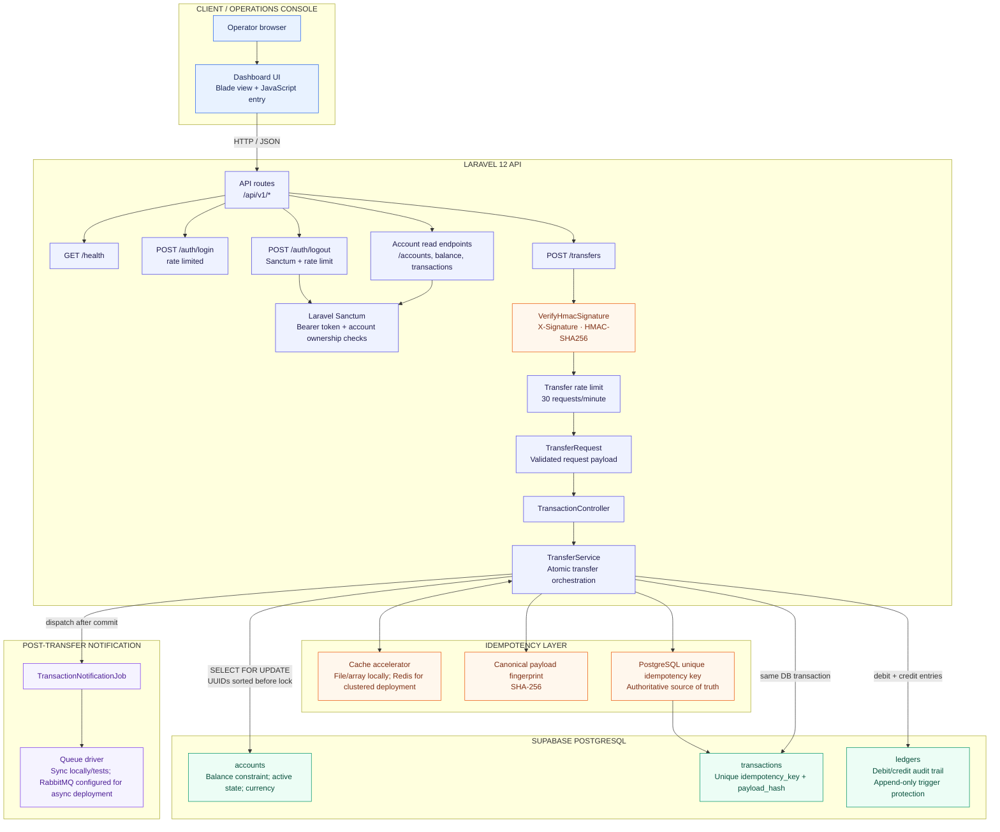
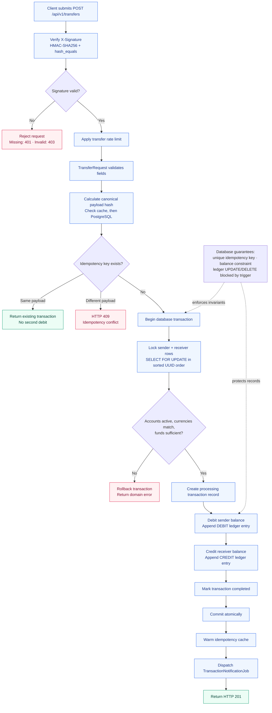

# SentinelPay — Architecture Diagram

This diagram is based on the current repository routes, controllers, transfer service, models, and architecture notes.

> **Frontend note:** The current tree contains `resources/views/welcome.blade.php` and `resources/js/sentinelpay.js` for the dashboard UI. The README also describes React/Vite as a target/frontend foundation, so confirm that migration status before treating React as the deployed UI.

## 1. Runtime architecture

## 2. Transfer lifecycle and integrity controls

## Implementation references

- API routes: [`routes/api.php`](../routes/api.php)
- HMAC verification: [`app/Http/Middleware/VerifyHmacSignature.php`](../app/Http/Middleware/VerifyHmacSignature.php)
- Request validation and API response handling: [`app/Http/Controllers/Api/TransactionController.php`](../app/Http/Controllers/Api/TransactionController.php), [`app/Http/Requests/TransferRequest.php`](../app/Http/Requests/TransferRequest.php)
- Transfer transaction, row locks, idempotency, and job dispatch: [`app/Services/TransferService.php`](../app/Services/TransferService.php)
- Full engineering notes: [`docs/architecture_docs.md`](architecture_docs.md)
